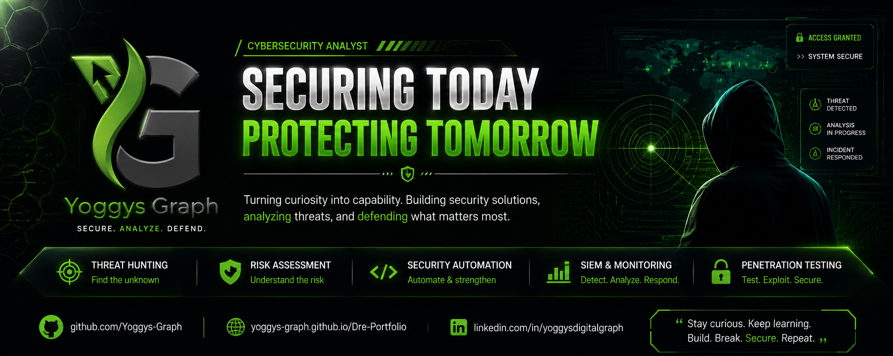
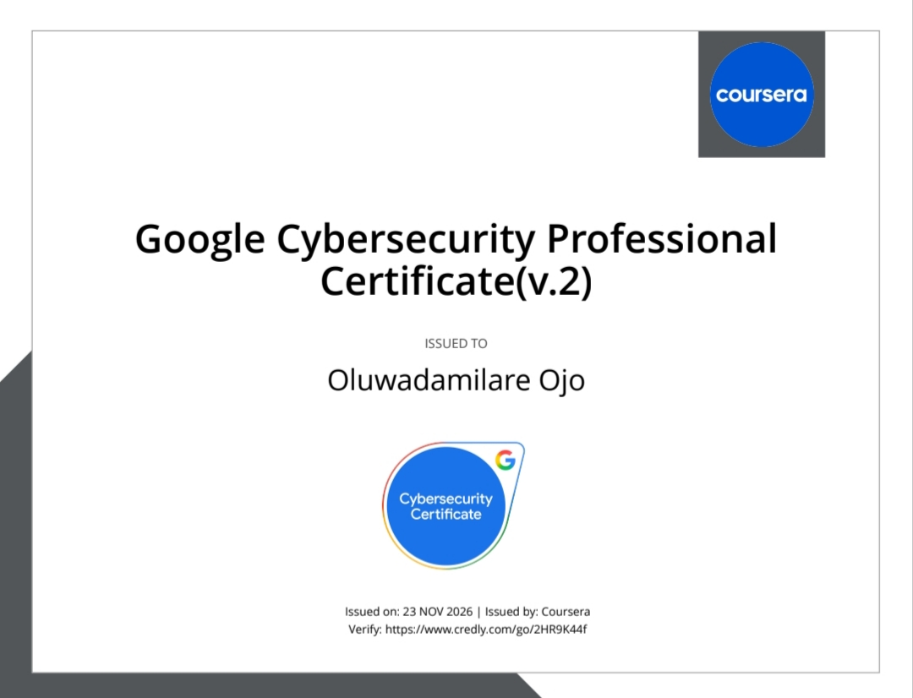
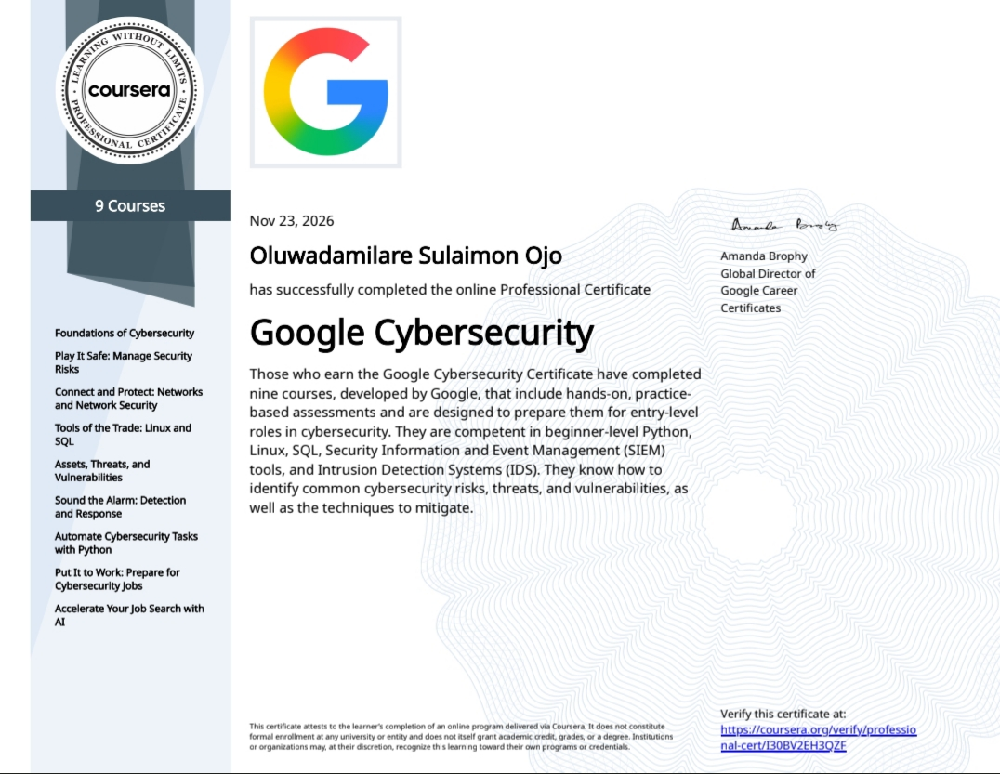
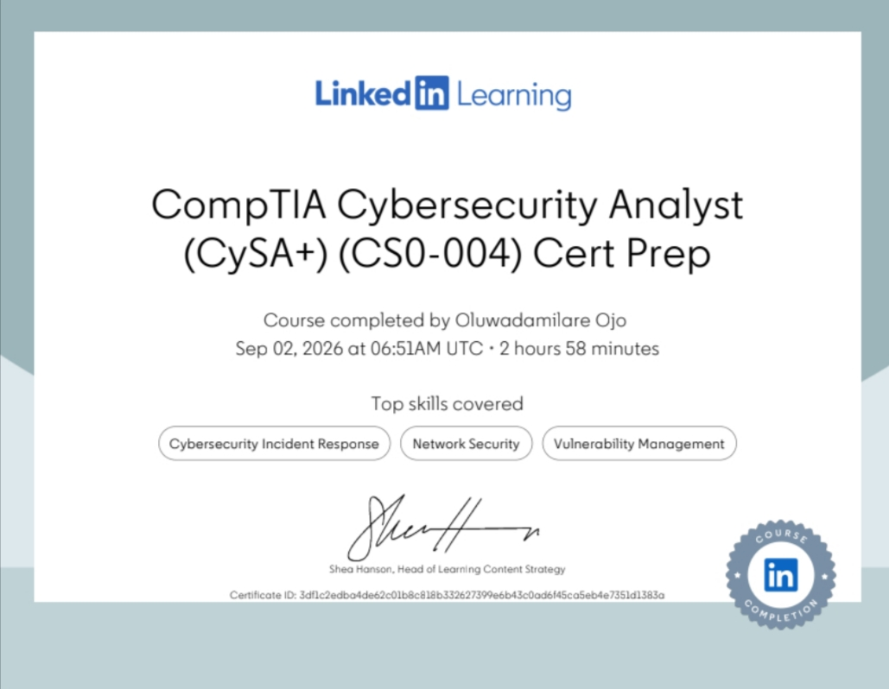
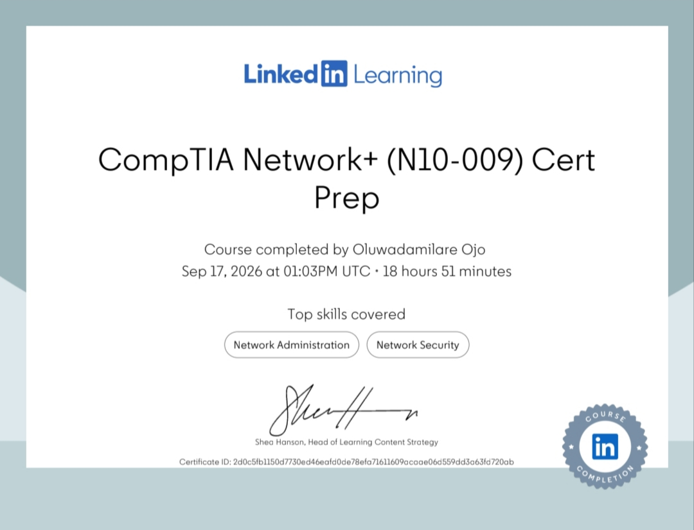

  
  

# 👋 Hi, I'm Oluwadamilare Ojo

🎯 Aspiring Cybersecurity Professional | [SOC Analyst / Security Engineer / Cloud Security]  
📍 Based in [Lagos]  
📧 Email: [oluwadamilare4jesus@gmail.com]  
🔗 LinkedIn: [www.linkedin.com/in/oluwadamilare-ojo-b3a8ba194]

---

## 🧠 About Me

I’m a Cybersecurity Analyst with a background in Computer Science and over a decade of experience in visual design and operations. While my earlier career taught me how to spot subtle visual patterns, manage deadlines under pressure, and communicate complex ideas clearly, I’ve transitioned those strengths into protecting systems—building hands-on experience in SIEM monitoring, phishing analysis, IAM, and incident investigation through 25+ security labs and industry simulations with Mastercard and Tata. I’m looking to join a SOC or security team where I can help detect threats early and translate technical findings into clear action.

I actively practice through labs, CTF challenges, and real-world simulations.

---

## 🛠️ Skills & Tools

**Security Tools**
- Wireshark  
- Splunk  
- Nmap

**Technologies**
- Linux (Kali, Ubuntu)  
- Windows Security  
- Networking (TCP/IP, DNS, HTTP)
- GitHub (Action, Workflow)

**Programming**
- Python
- SQL (MySQL / MariaDB)
- HTML/CSS
- JavaScript
- Java

---

## 📂 Portfolio Projects

### 🔍 Phishing Email Analysis
- Completed a job simulation where I served as an analyst on Mastercard’s Security Awareness Team.
- Helped identify and report security threats such as phishing.
- Analyzed and identified which areas of the business needed more robust security training and implemented training courses and procedures for those teams.

- Tools: PPTX and PDF Assesibility

👉 [View Project](https://github.com/Yoggys-Graph/Phishing_Analysis.git)

---

### 📊 SIEM Lab (SIEM dashboard)
- Built a home SOC lab using SIEM dashboard 
- Ingested logs and created detection queries  
- Investigated suspicious login attempts
- Blocked the suspicious IP address
- Detect the location of the IP address

👉 [View Project](https://github.com/Yoggys-Graph/SIEM-Dashboard/tree/main)

---

### 🧑🏿‍💻 Identity Access Management (IAM) / Linux Bash
- Manage Authorization
- IAM assessment and design
- Access control mechanisms
- Linux bash 

👉 [View Project](https://github.com/Yoggys-Graph/IAM_Authorization_Mastery.git)

👉 [View Project](https://docs.google.com/document/d/1smxWHIkObJAgu-ekcxEzJWiekfNyjDVBq3_GogZjarQ/edit?usp=drivesdk)

---

### 📊 Incident Report TCPDump / Security hardening 

- Capture network traffic using TCPDump.
- Analyze TCP/IP communication.
- Identify suspicious network behavior.
- Investigate unusual connections and ports.
- Identify potential Indicators of Compromise (IOCs).
- Reconstruct the incident timeline.
- Assess the potential security impact.
- Apply Linux security-hardening techniques.
- Validate that hardening measures were effective.
- Document the investigation using a professional incident-response format.

👉 [View Write-ups](https://github.com/Yoggys-Graph/Incedent-Report.git)

---

### 🌐 Web Application Testing

- Tested vulnerable apps (OWASP Juice Shop)  
- Identified XSS and SQL injection vulnerabilities  
- Used Burp Suite for exploitation  

👉 [View Project](link-to-project)

---

### 🐍 Python Security Tools
- Automate cybersecurity tasks with Python
- Create new, user-defined Python functions
- Use regular expressions to extract information from text
- Practice debugging code
- Log Analyzer  
- Password Strength Checker  

👉 [View Project](https://docs.google.com/document/d/1gAVSWFBXIy8pCBoIsePqSHlmwEU3Aymx2fLnyfE9750/edit?usp=drivesdk)

---

### 🧪 CTF Write-ups

- TryHackMe Rooms
- Google Skills Lab
- Hack The Box Challenges  
- picoCTF Exercises  

👉 [View Write-ups](https://github.com/Yoggys-Graph/Penetration-Teating--CTF-.git)

---

## 🎓 Certifications

- [Credly/Google; Google Professional Cybersecurity Certificate] – [Coursera]

   

    👉 [View Certificate Credly](https://www.credly.com/badges/4db85a7f-d290-4c96-9f6e-25fac8d24375)

     
  
  👉 [View Certificate 9](https://coursera.org/share/caff779efc6fef852f3ea28d33ea8b63)

  👉 [View Certificate 1](https://coursera.org/share/89750ee59bc71968018a2d60c2b6242c)
  
  👉 [View Certificate 2](https://coursera.org/share/5359a802cfc930024cbdc0ceff40a7b2)

  👉 [View Certificate 3](https://coursera.org/share/ae73730c451c4033255f480c3ec57751)

  👉 [View Certificate 4](https://coursera.org/share/36239fe887b9e5b0d7b8b929a31c3b95)

  👉 [View Certificate 5](https://coursera.org/share/4e7059220addaece3b97ac10ebe94ae9)
  
  👉 [View Certificate 6](https://coursera.org/share/5c87c88a543bbd5f5758916f6e68d9e4)
  
  👉 [View Certificate 7](https://coursera.org/share/02f6662bcd2b805c479ebc12bd4b1782)
  
  👉 [View Certificate 8](https://coursera.org/share/074236de93f743ef57eb8709ebc95388)

--

- 

--

- 

--

- [Certificate of Completion; Introduction to Programming (Python)] – [Ustacky]    
👉 [View Certificate](https://drive.google.com/file/d/1FjXLmTG00jVr8BMejV9mkmuG6SlLRfj3/view?usp=drivesdk)

--

- [Certificate of Completion; Responsive Web Development] – [Coursera]    
👉 [View Certificate](https://coursera.org/share/d4ef2988355716325b8bfea82f0377d9)

--

SIMULATIONS:

- [Certificate of Completion; Master Card Phishing Email Simulation] – [Forage]    
👉 [View Certificate](https://forage-uploads-prod.s3.amazonaws.com/completion-certificates/mfxGwGDp6WkQmtmTf/vcKAB5yYAgvemepGQ_mfxGwGDp6WkQmtmTf_6a242dd7847afa3019eb733e_1780766804122_completion_certificate.pdf)

--

- [Certificate of Completion; DataCom Introduction to Cloud Job Simulation] – [Forage]     
👉 [View Certificate](https://drive.google.com/file/d/1RMt3T16siFptGsE3X1_0PI1taPe1hFis/view?usp=drivesdk)

--

- [Certificate of Completion; TATA Cybersecurity Analyst Job Simulation] – [Forage]     
👉 [View Certificate](https://drive.google.com/file/d/1ATcfAw82LMW0eaSc1-FWDHGFkPGmMego/view?usp=drivesdk)

---

## 📈 Current Learning

- Advanced SIEM & Threat Hunting  
- Cloud Security (AWS/Azure)  
- MITRE ATT&CK Framework  

---

## 🤝 Let's Connect

I'm open to:
- Entry-level cybersecurity roles  
- Internships  
- Collaboration on security projects  

📧 Reach me at: [oluwadamilare4jesus@gmail.com]

---

⭐ *Feel free to explore my repositories and follow my journey!*
